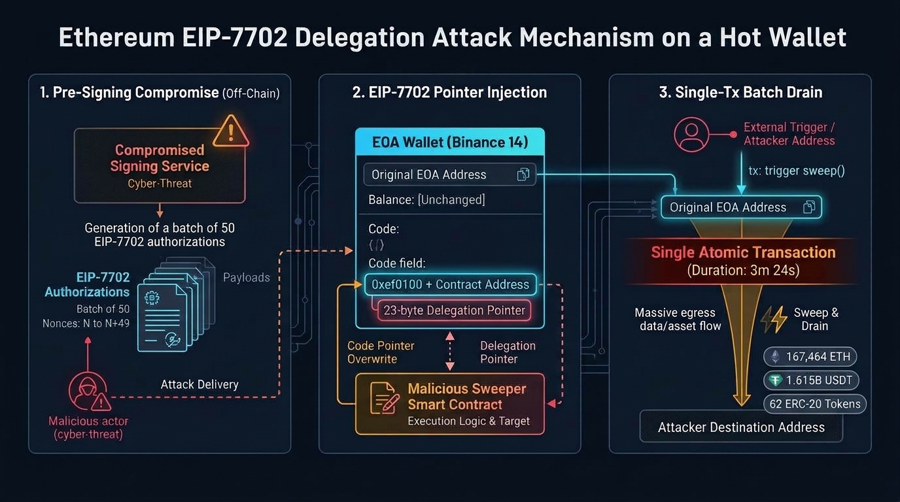

> **核心导读与研报信源（2026-11-09 官方报告核验更新版）**：
> * **【11月3日/4日官方调查报告增补说明】**：本文初版发布于事发当日（2026 年 10 月 30 日），彼时基于链上交易指纹与第三方安全机构初判进行了分钟级还原。2026 年 11 月 3 日至 4 日，币安正式发布《[29 October 2026 Binance Security Incident: Initial Findings and Response Update](https://www.binance.com/en/blog/community/3229153443759566763)》（中文版见《[2026年10月30日币安安全事件：调查初步发现与应对进展更新](https://www.binance.com/zh-CN/blog/%E7%A4%BE%E5%8C%BA/3229153443759566763)》及 [币安广场官方长文](https://www.binance.com/zh-CN/square/post/384312159834579)），首次公开了横跨 **5 个月（6 月至 10 月）** 的内网渗透全貌、三名涉事工程师（Engineer A / B / C）的失守路径以及链上撤销延迟的真实原因。本次更新结合币安官方报告、[美国联邦调查局（FBI）归因通报](https://abcnews.com/Business/binance-estimates-security-breach-impact-63-billion/story?id=137698510)、[Trail of Bits 签名架构审计](https://blog.trailofbits.com/2026/11/06/after-binance-check-what-your-signing-systems-can-approve/)、[Hacken 31 分钟深度复盘](https://hacken.io/insights/binance-hack/)、[Aviatrix 威胁研究](https://aviatrix.ai/threat-research-center/after-binance-check-what-your-signing-systems-can-approve/)、[ACAMS 合规评论](https://www.acams.org/en/opinion/binance-hack-compliance-story-four-lessons-financial-crime-teams) 与 [SIAMBC 调查梳理](https://siambc.com/zh/blogs/learn/binance-hack-initial-findings-fake-job-interview-ai-eip-7702-2026-zh-cn)，**全量更新官方时间轴，并在正文中逐项批注此前早期推测的准确之处与客观误差**。
> * **早期专题线索与链上取证信源**：感谢深度观察创作者 **[云雷](https://v.douyin.com/a5uu-qxlg0s/)** 发布的专题解析作品《[今早 BN 被盗 60 亿美金，EIP-7702 的劫持漏洞与原理解析](https://v.douyin.com/a5uu-qxlg0s/)》；并交叉引用 **[TRM Labs 官方溯源报告](https://www.trmlabs.com/resources/blog/north-korea-steals-usd-6-36-billion-from-binance-in-the-largest-hack-in-history)**、**[Bitquery 十链资金流向审计](https://bitquery.io/investigations/binance-hack)** 与 **[做市商滑点损耗分析](https://bitquery.io/investigations/binance-hack-who-profited)**、慢雾（SlowMist）创始人 **[余弦（Cos）技术定性](https://news.marsbit.co/flash/20261030084915298213.html)**（参见 **[PANews 报道](https://www.panewslab.com/zh/articles/01a18a4a-804e-737a-ac3c-d01404838778)**）、**[The Defiant 交易权限拆解](https://thedefiant.io/news/security/binance-labeled-wallet-swept-minutes-after-eip-7702-delegation)**、**[Elliptic 威胁情报分析](https://www.elliptic.co/insights/binance-largest-hack-in-history/)**、**[Blockaid 签名系统风险报告](https://blockaid.io/blog/binance-55b-hack-using-advanced-ai-models-blockaid-detects-the-biggest-theft-in-crypto-history)**、**[Hard2bit 签名架构与 DORA 合规复盘](https://hard2bit.com/en/blog/binance-hack-eip-7702-signing-infrastructure-dora/)**、**[律动 BlockBeats 深度技术复盘](https://news.cnyes.com/news/id/6641689)**、**[40 分钟完整时间线追踪](https://m.cnyes.com/news/id/6641566)** 及 **[Etherscan 链上原始交易记录](https://etherscan.io/tx/0x53bd38b816c23e74134786c29a8c18d792777998a3b9326047b583100e88e2f3)**。
> * **核心命题**：北京时间 2026 年 10 月 30 日凌晨 04:05 至 08:10（UTC 时间 10 月 29 日 20:05 至 30 日 00:10），币安（Binance）分布在多条公链上的热钱包遭遇协同洗劫，官方核定受影响资产达 **63.4 亿美元**（链上按转出瞬时价初算约 **63.6 亿美元**，规模为 2025 年 2 月 Bybit 15 亿美元被盗案的 **4.2 倍**）。一场始于 6 月篡改版 Homebrew 安装包与 9 月逼真假招聘面试的潜伏行动，如何借助**币安内部 AI 工具**完成横向跳板，并通过 **50 笔连续 Nonce 预签名**与 **EIP-7702 代码委派**在 3 分 24 秒内搬空 `Binance 14`？为什么在没有丢失任何一把完整私钥的情况下，多方安全计算（MPC）反而延缓了应急撤销？

---

### 一、 交互式全景看板：五个月完整攻击链、EIP-7702 指针拆解与早期推测勘误

我们将币安官方披露的 **6 大演进阶段（从 2026 年 6 月供应链刺探到 10 月 30 日 00:10:35 UTC 撤销委托）**、**10 月 30 日早期推测 vs 11 月 3 日官方报告逐项勘误矩阵**、**EIP-7702 委托指针（`0xef0100`）三步攻击架构图**以及**多链受损与 28.5 亿美元冻结分布**封装为如下深色交互式看板（手机与平板端轻触任意时间线卡片，即可在卡片正下方就地展开链上取证与官方勘误详情）：

<p align="center" style="margin-top: 15px;">
  <a href="/dashboards/binance_eip7702_hack_analysis.html" target="_blank" class="btn btn-default">在新窗口全屏浏览看板 ↗</a>
</p>

<iframe src="/dashboards/binance_eip7702_hack_analysis.html" width="100%" height="960px" frameborder="0" style="border-radius: 8px; border: 1px solid #24324f; margin-top: 15px; box-shadow: 0 4px 12px rgba(0,0,0,0.25);"></iframe>

---

### 二、 官方调查报告核验：早期链上推测误差批注与核心量化矩阵

在 10 月 30 日事发后的最初几个小时里，安全社区只能透过链上字节码与零星公告进行逆向推演。随着 11 月 3 日 [币安官方初步调查报告](https://www.binance.com/en/blog/community/3229153443759566763) 与 [Hacken](https://hacken.io/insights/binance-hack/)、[Trail of Bits](https://blog.trailofbits.com/2026/11/06/after-binance-check-what-your-signing-systems-can-approve/) 等机构复盘的披露，我们对初版博文中的全部核心论断进行了逐项交叉审计。

#### 1. 10月30日早期链上推测 vs 11月3日官方报告：六大误差修正与三项证实

| 核查维度 | 初版博文（10月30日早期推测） | 币安官方调查报告与区块级复盘（11月3日–6日披露） | 校验状态与误差根因批注 |
| :--- | :--- | :--- | :---: |
| **1. 渗透周期与内网跳板路径** | 推测源于“事发前 3 天（10月27日）”的 Contagious Interview 伪装面试，单台 DevOps 笔记本中毒后直接连入签名服务容器。 | **实为横跨 5 个月、波及 3 名工程师的四阶段复合攻击链**：① **6月**钱包运维 Engineer A 误装篡改版 Homebrew，虽被及时换机轮换凭证，但暴露了钱包团队人员拓扑；② **9月**钱包开发 Engineer B 经两轮逼真假招聘视频面试，在工作电脑运行含 0-day 后门的作业，替换 `/opt/homebrew/.../pyenv` 二进制文件并绕过 EDR；③ **10月20日**黑客以 Engineer B 电脑为起点，**滥用币安内部 AI 工具作为跳板**，横向控制 Engineer A 与 Engineer C 的电脑，并在 A 电脑上拿到**容器部署权限令牌**；④ **10月29日 17:15–19:56 UTC** 登录 Engineer C 电脑，用 A 的令牌部署恶意容器切入钱包签名服务（[Binance Blog](https://www.binance.com/en/blog/community/3229153443759566763)）。 | ⚠️ **重大修正**<br>早期低估了潜伏跨度，且未料到“内部 AI 工具”充当了跨终端横向移动的核心跳板。 |
| **2. 为何 3 小时 49 分钟未撤销 EIP-7702 委托？** | 看到 06:55 BJT 币安用同一私钥抢救零碎代币却未撤委托，推测是“运维管理后台看不见 `0xef0100` 字段或漏写了撤销按钮，导致人为疏忽”。 | **实为 MPC（多方安全计算）架构的应急死锁悖论**：① 暂停提币服务无法清除已上链的 EIP-7702 委托；② 因热钱包采用 **MPC 分片技术**，**根本不存在一把可直接拿来签发撤销交易的单一完整私钥（No single private key）**；③ 常规 MPC 签名接口当时仅支持标准转账且处于污染隔离中，安全团队被迫在当晚**临时现场编写并测试一套专用的 MPC 零地址授权程序**，直至 00:10:35 UTC（08:10:35 BJT）才完成清零（[Binance Blog](https://www.binance.com/en/blog/community/3229153443759566763)、[Hacken](https://hacken.io/insights/binance-hack/)）。 | ❌ **推测有误**<br>并非运维看不见或忘了撤，而是 MPC 无单点私钥 + 缺乏预置的 `0x04` 撤销签名通道。 |
| **3. 内部告警触发时点与 90% 资金流出窗口** | 推测黑客在 04:04–04:25 BJT 的 20 分钟内完成了“币安毫无察觉的同步闪电战”。 | **首波异动后已触发内部告警，但 90% 资金在告警响起后流出**：20:05–20:09 UTC 瑞波链（2.3346亿 XRP）及随后的 Solana（97.05万 SOL）、Optimism（4,420万 OP）转出后，币安**已收到大额转账内部告警并立即启动调查**；但因签名容器已被脚本接管并生成预签名，后续 18,270 BTC（20:20 UTC）、以太坊主清扫（20:24:23 UTC）与波场（20:22 UTC）等**约 59 亿美元（超总额 90%）是在首道告警触发之后才在链上落地的**（[Binance Blog](https://www.binance.com/en/blog/community/3229153443759566763)、[Hacken](https://hacken.io/insights/binance-hack/)）。 | ⚠️ **时序修正**<br>告警并非没响，而是“人工调查排障速度”远慢于“容器自动化脚本跨链并发签发速度”。 |
| **4. 07:56 BJT 最后一笔 2,961.9 ETH 的性质** | 推测黑客在 07:56 BJT（23:56 UTC）仍能实时发起第 7 次主动清扫调用。 | **实为早期广播的滞后待处理（Pending）交易**：币安官方核实，该笔于 23:56 UTC（07:56 BJT）最终上链确认的 `2,961.9 ETH` 转账，实际上在早些时候便已广播至网络，只是长期滞留在内存池待处理状态（remained pending），此后未再发生任何未授权流出（[Binance Blog](https://www.binance.com/en/blog/community/3229153443759566763)）。 | ⚠️ **细节修正**<br>混淆了“交易广播时间”与“区块最终确认（Finalised）时间”。 |
| **5. 50 笔预签名命中位点与 Optimism 受损额** | 看板示意图中以 `nonce = 18,914,792` 举例；将 Optimism 流出额低估为 ~$480 万。 | **精准命中 Nonce 为 `18,914,809`（第 35 份），OP 实际流出 4,420 万枚**：在 `18,914,775`–`18,914,824` 的 50 份连续授权中，前 34 份已过期、后 15 份未到达，唯独第 35 份 **`18,914,809`** 在区块 `26,300,753` 精准命中；Optimism 热钱包实际转出 **4,420 万枚 OP**，后于 10月31日由 Optimism 治理拦截收回 4,400 万枚 OP（[Hacken](https://hacken.io/insights/binance-hack/)）。 | ⚠️ **数据校准**<br>已按区块原始账本修正命中 Nonce 序号与 OP 追回明细。 |
| **6. 受损总额、冻结金额与“98% 补足”口径** | 采信链上首日估算：流出 **$63.6 亿**，冻结 **~$27.0 亿**。 | **官方核定受损约 $63.4 亿美元，累计冻结/拦截约 $28.5 亿美元（~45%）**：其中 Tether 冻结升至 17.7 亿 USDT、Circle 冻结超 11 亿 USDC。同时币安动用自有资金（SAFU 基金、合约保险基金与公司金库）全额兜底，截至 10月31日**已补足 98% 受影响代币储备**（零知识 PoR 可验），11月1日 06:00 UTC 恢复提币（[Binance Blog](https://www.binance.com/en/blog/community/3229153443759566763)、[SIAMBC](https://siambc.com/zh/blogs/learn/binance-hack-initial-findings-fake-job-interview-ai-eip-7702-2026-zh-cn)）。 | ⚠️ **口径更新**<br>必须严格区分“公司自掏资金补足 98% 账面储备”与“链上冻结 45% 赃款”。 |
| **7. 核心定性：私钥未泄露 + 7702 零漏洞 + 朝鲜归因** | 依据 50 笔连续 Nonce 盲狙推断“黑客未拿到明文私钥，而是劫持了内部签名服务接口”；定性 EIP-7702 协议无漏洞；归因朝鲜 TraderTraitor。 | **三项核心推论 100% 被官方与 FBI 证实**：币安官方与 [Trail of Bits](https://blog.trailofbits.com/2026/11/06/after-binance-check-what-your-signing-systems-can-approve/) 均确认私钥从未被提取外泄，系签名服务被容器脚本滥用；EIP-7702 属于正常链上委托机制被武器化；[FBI 于 10月31日正式发文](https://abcnews.com/Business/binance-estimates-security-breach-impact-63-billion/story?id=137698510)确认系朝鲜（DPRK）TraderTraitor 所为。 | ✅ **完全证实**<br>早期基于密码学工程特征的核心推演完全经受住了官方复盘检验。 |

---

#### 2. 核心量化指标全景汇总表（截至 2026 年 11 月初权威校准）

| 评估维度 | 最新权威核定数据 | 链上取证与官方披露详情（附一手信源溯源） |
| :--- | :--- | :--- |
| **1. 累计受损资产规模** | **官方核定 ~$63.4 亿美元**<br>（链上瞬时价口径 $63.6 亿） | 币安 [11月3日官方报告](https://www.binance.com/en/blog/community/3229153443759566763) 核定受影响资产约为 **63.4 亿美元**（[TRM Labs](https://www.trmlabs.com/resources/blog/north-korea-steals-usd-6-36-billion-from-binance-in-the-largest-hack-in-history) 按转出时刻市价逐笔折算为 63.6 亿美元），创下加密史最大单次被盗纪录（约为 2025 年 2 月 Bybit 15 亿美元案的 **4.2 倍**）。 |
| **2. 攻击者身份与年度防线** | **朝鲜 TraderTraitor**<br>（币安年内曾拦截 57 起） | [FBI 正式通告](https://abcnews.com/Business/binance-estimates-security-breach-impact-63-billion/story?id=137698510) 归因于朝鲜国家级黑客组织 **TraderTraitor**（据 [ACAMS/TRM 统计](https://www.acams.org/en/opinion/binance-hack-compliance-story-four-lessons-financial-crime-teams)，朝鲜自 2017 年累计窃取 128 亿美元加密资产，仅 2026 年即达 74 亿美元，占全年加密被盗总额的 85%）。币安披露 2026 年全年曾检测并阻断 **57 起**疑似朝鲜背景的网络威胁，但第 58 次通过多阶段迂回撕开了防线。 |
| **3. 预签名盲狙批次** | **单笔 50 份连续 Nonce**<br>（第 35 份 `18,914,809` 命中） | 针对 `Binance 14` 高频提币导致交易计数器（Nonce）不断跳动的特性，攻击者通过被攻陷签名接口批量生成了 Nonce 从 `18,914,775` 到 `18,914,824` 的 **50 份连续授权**，于 20:20:59 UTC（区块 `26,300,753`）单笔上链，其中 `18,914,809` 精准命中（[Hacken](https://hacken.io/insights/binance-hack/)）。 |
| **4. 黄金抢救窗口与首笔清扫** | **17 个区块 / 3 分 24 秒**<br>（Gas 仅 0.0004 ETH） | 从 20:20:59 UTC（区块 `26,300,753`）写入 `0xef0100` 委托指针，到 20:24:23 UTC（区块 `26,300,770`）触发 [首笔清扫交易 `0x53bd38b8...`](https://etherscan.io/tx/0x53bd38b816c23e74134786c29a8c18d792777998a3b9326047b583100e88e2f3)，中间间隔 **17 个区块（3 分 24 秒）**，单笔转走 **167,464.25 ETH、16.15 亿 USDT 及 62 种代币（~$25.3 亿）**，钱包仅剩 1 ETH。 |
| **5. 恶意委托驻留时长** | **3 小时 49 分 36 秒**<br>（20:20:59 → 00:10:35 UTC） | 因热钱包采用 MPC 架构无单一私钥可立即撤销，恶意指针在 `Binance 14` 上持续驻留 **3 小时 49 分 36 秒**（距首轮主清扫 3 小时 46 分钟），期间后续流入资金及关联智能账户 `0xEe7a…4055` 内的 USDC 遭到多次追加清扫，直至 10月30日 00:10:35 UTC 指向零地址清零（[Binance Blog](https://www.binance.com/en/blog/community/3229153443759566763)）。 |
| **6. 冻结拦截 vs 黑客控制敞口** | **已冻结/拦截 ~$28.5 亿（45%）**<br>黑客控制无冻结风险资产 ~$32.5 亿 | 稳定币占被盗总额的 54%，但贡献了 **94% 的冻结追回量**：Tether 冻结 **17.7 亿 USDT**、Circle 冻结 **>11 亿 USDC**、Ripple 冻结 **4,050 万 RLUSD**、WLFI 冻结 **2,780 万 USD1**、Arbitrum 委员会夺回 **$3,000 万**、Optimism 治理收回 **4,400 万 OP**。黑客承受 12%–26% 滑点折价将 7.86 亿美元稳定币强换为 ETH/TRX 后，在 800+ 地址中控制约 **58.4 万枚 ETH、18,270 枚 BTC、2.33 亿枚 XRP** 等约 **32.5 亿美元**抗审查资产（[Hacken](https://hacken.io/insights/binance-hack/)）。 |
| **7. 平台赔付兜底与恢复提币** | **98% 资产已补足（10月31日）**<br>11月1日恢复提币净流出仅 2.1% | 币安动用 SAFU 基金、期货保险基金与公司金库预留 >100% 赔付资金，截至 10月31日完成 **98% 受影响代币补足**（11月2日完成涵盖 44 个币种的零知识储备证明 PoR）；11月1日 06:00 UTC 恢复提币当天净流出 36.4 亿美元，仅占币安总托管资产的 **2.1%**，未引发挤兑危机（[Hacken](https://hacken.io/insights/binance-hack/)）。 |

---

### 三、 科普图解：什么是 EIP-7702？它如何把热钱包变成黑客的“提款机”？

对于非以太坊底层开发背景的读者，要看懂这场 63.4 亿美元惊天劫案的技术内幕，首先需要理清一个最核心的因果关系：**EIP-7702 不是黑客撬开币安金库大门的“万能钥匙”，而是黑客在骗取金库签名机盖章之后，用来在 3 分钟内搬空整座金库的“全自动传送带”。**



#### 1. 背景科普：以太坊的两类账户与 EIP-7702 的设计初衷

在以太坊虚拟机（EVM）的传统架构中，账户被严格划分为两个互不相通的物种：

1. **外部拥有账户（EOA, Externally Owned Account）**：即普通用户和交易所最常用的私钥钱包（如本次涉事的 `Binance 14`，地址 `0x28C6…1d60`）。它由一对加密公私钥控制，账户状态里的代码字段（`code`）永远是空的（`0x`）。
   * **天然短板**：EOA 极其“笨拙”，不支持编写程序逻辑。如果钱包里有 ETH 和 63 种 ERC-20 代币，想要全部转走，私钥持有人必须老老实实签发 **64 笔独立交易**，不仅耗时漫长，而且在交易所环境下，短时间内连续发出 64 笔异常提币极易触发风控系统的频率熔断。
2. **智能合约账户（Smart Contract Account）**：由部署在链上的代码控制，没有私钥，但支持复杂的批量打包交易（Batching）、社交恢复与权限分级。

为了让数十亿普通 EOA 钱包无需迁移地址就能享受智能合约的便利，以太坊在 **2025 年 5 月 Pectra 硬分叉升级**中正式上线了由 Vitalik Buterin 等人联合提出的 **[EIP-7702 标准](https://eips.ethereum.org/EIPS/eip-7702)**（引入了全新的交易类型 `0x04`）。

用一句话通俗概括 **EIP-7702 的工作机制**：
> **它允许一个普通私钥钱包（EOA）签发一张“代码租用授权书”，在自己的 `code` 字段里写入一个 23 字节的指针（`0xef0100` + 目标智能合约地址）。从此以后，这个钱包的地址、余额和私钥统统不变，但任何人调用这个钱包地址时，以太坊虚拟机会自动加载那份外挂合约的代码，并在该钱包自己的资产抽屉里执行。**

从计算机底层状态来看，普通 EOA 账户与被注入 EIP-7702 指针后的账户状态差异如下：

$$\text{Standard EOA State: } \quad \sigma[\text{Binance 14}]_{\text{code}} = \varnothing \quad (\text{keccak256} = \texttt{0xc5d246...})$$

$$\text{EIP-7702 Delegated State: } \quad \sigma[\text{Binance 14}]_{\text{code}} = \underbrace{\texttt{0xef0100}}_{\text{3-byte Magic Prefix}} \parallel \underbrace{\texttt{0x63e8...6fAe}}_{\text{20-byte Attacker Contract}} \quad (23\text{ Bytes})$$

这里最关键的设计细节是**执行上下文（Execution Context）**：当外部地址向 `Binance 14` 发起调用时，EVM 采用类似于 `DELEGATECALL`（委托调用）的语义去执行黑客合约 `0x63e8…6fAe` 中的逻辑——这意味着在黑客代码运行期间，环境变量中的“当前账户”（`address(this)`）依然是 `Binance 14` 本身！因此，黑客代码无需再索取任何私钥签名，就可以直接以 `Binance 14` 主人的身份，在**同一笔原子交易**内调用 63 个代币合约的 `transfer()` 函数，把所有资产一次性划走。

---

#### 2. 致命盲区：为什么交易所的 HSM / MPC 风控系统没能拦住它？

既然 EIP-7702 需要 `Binance 14` 的密钥签发授权才能生效，而币安拥有行业顶级的硬件安全模块（HSM，即物理隔离的加密签名黑盒）与多方安全计算（MPC，将私钥分片保存在多台服务器中协同签名），为什么还会签出这份要命的授权？

正如 [币安 11 月 3 日官方调查报告](https://www.binance.com/en/blog/community/3229153443759566763)、[Trail of Bits 深度审计](https://blog.trailofbits.com/2026/11/06/after-binance-check-what-your-signing-systems-can-approve/) 与 [Blockaid 首席执行官 Ido Ben-Natan](https://hard2bit.com/en/blog/binance-hack-eip-7702-signing-infrastructure-dora/) 所共同揭示的：**HSM 与 MPC 保护的是“私钥不被明文偷走”，但只要上游签名服务（Wallet Signing Service）缺乏严格的“交易意图与策略校验”，一台拥有签名调用权限的受控容器就能在不提取私钥的情况下将密钥武器化。**

大型交易所的热钱包每天要自动处理数以万计的用户提币请求，不可能由人工逐笔肉眼审批，必须依赖一套自动化的**签名前置审批流水线（Pre-Signing Policy Engine）**：

```
+-----------------------------------------------------------------------------------+
| 传统交易所热钱包自动签名风控模型 vs EIP-7702 降维打击                               |
+-----------------------------------------------------------------------------------+

【常规提币请求】 -> [风控规则引擎检查] -> 1. 转账金额 (Value) 是否超过单笔阈值？
                                       -> 2. 接收方地址 (To) 是否在风险黑名单？
                                       -> 3. ERC-20 transfer(to, amount) 额度是否异常？

【EIP-7702 授权】 -> [风控规则引擎检查] -> 1. 转账金额 (Value) == 0 ETH (无资金移动！)
                                       -> 2. 无 ERC-20 transfer 调用数据！
                                       -> 3. 签名结构：keccak256(0x05 || chain_id || address || nonce)
                                       ==> ❌ 旧版签名网关未校验业务提币单号，且未拦截 0x05 授权摘要！
```

> 📌 **【官方报告勘误与增补批注：内网是如何一步步失守到签名服务的？】**
> * **初版推测局限**：我们在 10 月 30 日初版中曾根据早期消息推测，攻击者是在事发前几天通过单次 Contagious Interview 钓鱼直接控制了一名 DevOps 工程师电脑并连入容器。
> * **官方披露的四步纵深突破真相**：[币安官方报告](https://www.binance.com/en/blog/community/3229153443759566763) 证实，这是一场**历时近五个月、环环相扣的接力渗透**：
>   1. **第一棒（6月情报测绘）**：钱包运维工程师 **Engineer A** 搜索安装 AI 编程工具时误装篡改版 Homebrew，虽被安全团队检测并换机重置凭证，但黑客已借机摸清了钱包基建团队的组织架构与同事名单。
>   2. **第二棒（9月假招聘突破终端）**：黑客锁定在求职平台注明币安经历的软件工程师 **Engineer B**，通过“假项目总监邀约 → 假 HR 真人视频面试（配套展示含生活照与视频的逼真社交账号） → 假 CEO 二面布置编程作业”的连环套，诱导 Engineer B 在工作 Mac 上运行恶意代码仓库，用 0-day 手法将 `/opt/homebrew/Cellar/pyenv/2.8.0/libexec/pyenv` 偷换为恶意版本，绕过终端杀毒软件（EDR）驻留。
>   3. **第三棒（10月20日内部 AI 工具横向跳板）**：攻击者从 Engineer B 的电脑出发，**利用币安内部部署的一套 AI 工具（Internal AI Tool）作为高权限跳板**，一举横向控制了 **Engineer A**（即 6 月换过电脑的钱包运维）与另一名钱包软件工程师 **Engineer C** 的设备，并在 Engineer A 电脑上缴获了一枚长期有效的**容器部署权限令牌（Container Deployment Token）**。
>   4. **第四棒（10月29日容器切入签名网关）**：攻击者登录 Engineer C 的电脑，用 Engineer A 的部署令牌拉起恶意容器，直接向内部钱包签名服务（Wallet Signing Service）发送脱离正常提币审批流的签名指令。正如 [Hacken](https://hacken.io/insights/binance-hack/) 所言：“一个不核对上游已批准提币单号、只要调用方在白名单环境内就有求必应的签名服务，本质上就像一台不设防的打印机。”

---

#### 3. 工程诡计：为什么要一口气打包“50 笔连续 Nonce 预签名”？

在链上取证中，最令安全研究员拍案叫绝（也最能暴露攻击者权限边界）的细节，是北京时间 04:20:59（20:20:59 UTC，区块 `26,300,753`）上链的那笔授权交易里，竟然整整齐齐塞满了 **50 份针对 `Binance 14` 的 EIP-7702 授权签名**，其交易计数器（`nonce`）从 `18,914,775` 一直排到 `18,914,824`（[Hacken](https://hacken.io/insights/binance-hack/)、[BlockBeats](https://news.cnyes.com/news/id/6641689)）。

为什么黑客不直接签 1 份，而要一口气签 50 份？这恰恰揭示了当时的真实攻防态势：

1. **严格的 Nonce 相等约束**：根据 EIP-7702 协议规范，每一份授权元组（Authorization Tuple）的签名内容定义为：
   $$\text{digest} = \text{keccak256}\Big(\texttt{0x05} \parallel \text{rlp}\big([\text{chain\_id}, \text{contract\_address}, \text{nonce}]\big)\Big)$$
   当验证者打包这笔交易时，EVM 会逐一校验列表中的授权元组：只有当元组里填写的 $\text{nonce}$ 与目标钱包 `Binance 14` 在**当前区块执行瞬间**的真实交易计数 $\text{nonce}_{\text{current}}$ **完全相等**时，委托才会生效；只要差了 1 个数，该份授权就会被静默跳过作废。
2. **高频热钱包的“移动靶”难题**：`Binance 14` 作为币安最繁忙的以太坊提币主钱包，每分钟都在自动向外发送正常用户的提币交易，其链上 $\text{nonce}_{\text{current}}$ 就像高速旋转的秒表一样时刻跳动。
3. **跨系统的时间差补偿（散弹枪盲狙策略）**：如果黑客已经把 `Binance 14` 的明文私钥偷到了自己电脑上，他完全可以在本地实时读取链上最新 Nonce 并毫秒级签出唯一准确的 1 份授权。他之所以必须**提前批量生成 50 个连号签名**，证明他当时**并没有拿到明文私钥**，而是通过被攻陷的币安内部签名服务接口（MPC 网关）批量提交了签名申请！为了防止在“从内部接口导出签名”到“通过外部黑客地址广播上链”的几分钟时间差内，`Binance 14` 因正常提币导致 Nonce 跑偏，攻击者干脆预留了覆盖未来 50 笔提币窗口的连续签名包：
   $$\{\text{Auth}_i \mid \text{nonce}_i = 18,914,775 + i, \quad i \in [0, 49]\}$$

> 📌 **【官方报告与区块取证核验批注】**：
> * 我们在初版博文中基于这 50 笔连续 Nonce 作出的**“私钥并未明文外泄，而是内部签名接口被异步调用”**的推论，被 [币安 11 月 3 日官方报告](https://www.binance.com/en/blog/community/3229153443759566763) 与 [Trail of Bits 报告](https://blog.trailofbits.com/2026/11/06/after-binance-check-what-your-signing-systems-can-approve/) **100% 证实**！
> * **命中位点精确校准**：根据 [Hacken 对区块 `26,300,753` 的逐笔解包](https://hacken.io/insights/binance-hack/)，在这 50 个连号签名（尾号 `775` 至 `824`）上链瞬间，前 **34 份**（`18,914,775`–`18,914,808`）已因 `Binance 14` 在这几分钟内的正常提币而过期作废，后 **15 份**（`18,914,810`–`18,914,824`）尚未到达，**唯独第 35 份（`nonce = 18,914,809`）正中靶心**，一举将 `Binance 14` 的代码字段改写为 `0xef0100` + `0x63e8…6fAe`！

---

### 四、 五个月完整官方时间轴与惊魂夜分钟级复盘（含早期推测误差批注）

结合 [币安 11 月 3 日官方调查报告](https://www.binance.com/en/blog/community/3229153443759566763)、[TRM Labs](https://www.trmlabs.com/resources/blog/north-korea-steals-usd-6-36-billion-from-binance-in-the-largest-hack-in-history)、[Hacken](https://hacken.io/insights/binance-hack/) 与 [Bitquery](https://bitquery.io/investigations/binance-hack)，我们将时间轴从原本的“案发前 36 小时”向前延伸至 **2026 年 6 月**，完整还原这场历时五个月的国家级 APT 攻击全貌（同时标注协调世界时 `UTC` 与北京时间 `BJT = UTC+8`）：

#### 第一阶段：五个月纵深潜伏——从篡改版 Homebrew、假招聘 `pyenv` 零日木马到内部 AI 工具跳板（2026 年 6 月 – 10 月 29 日）

* **2026 年 6 月｜供应链投毒与钱包团队拓扑暴露（官方新增披露）**：
  币安钱包开发运维工程师 **Engineer A（Wallet DevOps）** 在通过搜索引擎查找一款热门 AI 编程辅助工具时，误下载了被篡改的 **Homebrew** 安装包。币安安全团队迅速检测到异常，第一时间更换了其工作设备并轮换了全部相关凭证。**然而，攻击者在此次短暂入侵中已经摸清了 Engineer A 的岗位职责，以及与他协作的钱包基础设施团队成员名单（完成了关键的人事测绘）**（[Binance Blog](https://www.binance.com/en/blog/community/3229153443759566763)）。
* **2026 年 9 月｜双轮逼真假招聘与 `pyenv` 零日二进制替换（官方新增披露）**：
  基于 6 月获取的情报，攻击者在正规求职平台上精准锁定了简历中标明币安经历的软件工程师 **Engineer B**，由假冒“项目总监（Project Director）”发起猎头邀约：
  1. **第一轮视频面试**：假冒“HR 代表”与 Engineer B 进行了实时视频通话，并主动分享了一个布满个人日常照片与视频的社交媒体账号以消除戒心（欺骗性远超传统钓鱼）。
  2. **第二轮“CEO”面试与恶意作业**：在社交聊天软件中由假冒“虚构公司 CEO”面谈，临近结束时诱导 Engineer B 在**币安工作电脑**上下载并配置一份包含恶意代码仓库的“面试作业（assignment）”。
  3. **0-day 驻留手法**：该恶意脚本采用深度代码混淆，在安装配置过程中悄然替换了 macOS Homebrew 目录下的合法 Python 版本管理工具 `pyenv`，当时的终端安全防护软件（EDR）未能识别该 0-day 样本。币安官方披露的终端篡改指令链如下：
     ```text
     CREATE /opt/homebrew/Cellar/pyenv/2.8.0/libexec/pyenv_
     MODIFY pyenv_ → 3,414 B (写入恶意后门载荷)
     DELETE .../libexec/pyenv (3,344 B) ← 删除合法的原版 pyenv
     RENAME pyenv_ → pyenv (3,414 B) ← 狸猫换太子替换为恶意版本
     DELETE /opt/homebrew/bin/pyenv (3,414 B)
     ln (重建符号链接) + spawn zsh (拉起交互式 Shell 建立外部 C2 通信并抹除日志)
     ```
* **2026 年 10 月 20 日｜滥用“内部 AI 工具”横向控制两名核心钱包工程师（官方新增披露）**：
  潜伏近一个月后，攻击者以 Engineer B 的受控电脑为支点，**利用币安的一套内部 AI 工具（Internal AI Tool）作为横向移动跳板**，成功夺取了 **Wallet DevOps 工程师 A** 与另一名 **钱包软件工程师 C（Software Engineer C）** 的电脑控制权。攻击者很快在 Engineer A 的电脑上发现了一枚未设置短时效隔离的**容器部署权限令牌（Container Deployment Permission Token）**（[Binance Blog](https://www.binance.com/en/blog/community/3229153443759566763)）。
* **10 月 28 日上午 – 10 月 29 日 16:30 UTC（10 月 30 日 00:30 BJT）｜链上燃气筹备与三轮清扫器彩排**：
  * **10 月 28 日上午起**：攻击者主控发起地址 `0x7C86…5CA0` 从混币器 **Tornado Cash** 提取 3 笔各约 `0.1 ETH` 的燃气费（[TRM Labs](https://www.trmlabs.com/resources/blog/north-korea-steals-usd-6-36-billion-from-binance-in-the-largest-hack-in-history)）。
  * **10 月 29 日 02:29 – 14:24 UTC（10:29 – 22:24 BJT）**：部署首版测试合约 `0x19be…f2bf`，并在两个自备测试钱包上完成第 1、第 2 次 EIP-7702 实弹演练。
  * **10 月 29 日 15:59:11 UTC（23:59:11 BJT，区块 `26,299,449`）**：部署最终投产版、仅允许主控地址 `0x7C86…5CA0` 调用的无源码清扫器合约 **`0x63e8…6fAe`**，随后在第三个测试钱包上完成终极彩排并收回测试资金（[Hacken](https://hacken.io/insights/binance-hack/)）。
* **10 月 29 日 17:15 – 19:56 UTC（10 月 30 日 01:15 – 03:56 BJT）｜恶意容器切入钱包签名服务（官方新增披露）**：
  在链上完成彩排仅 1 小时 15 分钟后，攻击者正式登录 **Engineer C** 的电脑，使用从 **Engineer A** 电脑窃取的容器部署凭证，在生产环境中部署了一个恶意容器并触发攻击脚本，直接连通币安**内部钱包签名服务（Internal Wallet Signing Service）**，开始在正常提币审批流程之外批量请求多链交易签名（[Binance Blog](https://www.binance.com/en/blog/community/3229153443759566763)）。

---

#### 第二阶段：20 分钟多链并发洗劫、内部告警响起后的 59 亿美元出逃与 Binance 14 失守（10 月 29 日 20:05 – 20:25 UTC / 10 月 30 日 04:05 – 04:25 BJT）

* **20:05 – 20:09 UTC（04:05 – 04:09 BJT）｜第一枪在瑞波链（XRP Ledger）打响**：
  5 个币安 XRP 热钱包率先通过被劫持的签名服务签发转账，将 **2.3346 亿枚 XRP（价值约 2.96 亿美元）**集中转入单一黑客地址 `rK21t6…gfzMx`（[Binance Blog](https://www.binance.com/en/blog/community/3229153443759566763)、[TRM Labs](https://www.trmlabs.com/resources/blog/north-korea-steals-usd-6-36-billion-from-binance-in-the-largest-hack-in-history)）。
* **~20:10 UTC（04:10 BJT）｜Solana 与 Optimism 失守 + 币安收到首道内部告警（官方关键细节）**：
  * 币安 Solana 热钱包转出约 **970,500 枚 SOL（~$9,600 万）**；Optimism 热钱包转出 **4,420 万枚 OP**（同时 Arbitrum 与 Base 热钱包也开始流出资金）。
  * > 📌 **【官方报告勘误批注】**：
    > 1. 初版博文曾将 Optimism 流出额低估为 ~$480 万，币安官方报告确认 Optimism 热钱包实际转出了 **4,420 万枚 OP**（后于 10月31日由 Optimism 治理干预追回 4,400 万枚 OP）。
    > 2. **内部告警时点**：币安官方报告披露，**就在 XRP、SOL 与 OP 发生异常转出后（约 20:10 UTC），币安已经收到关于大额转账的内部告警（internal alert）并立即展开调查**！然而，由于攻击者容器脚本已进入全自动高速并发请求状态（且以太坊 50 笔预签名已生成完毕），在安全团队定位污染源并切断签名通道前的短短 14 分钟窗口内，**占全案 90% 以上的资金（约 59 亿美元）相继在 BTC、ETH 和 TRON 链上爆发流出**（[Hacken](https://hacken.io/insights/binance-hack/)）。
* **20:20 – 20:22 UTC（04:20 – 04:22 BJT）｜比特币 18,270 BTC 出逃与波场 6.28 亿美元沦陷**：
  * **比特币主网（20:20 UTC）**：币安 BTC 热钱包单笔转出 **18,270 枚 BTC（约 14.7 亿–14.8 亿美元）**，黑客在同一区块内立即启动 **剥离链（Peel Chain）** 将资金拆分为规整的 1,000 BTC 和 100 BTC 子钱包，分散静置在 19 个地址中。
  * **波场 TRON（~20:22 UTC）**：币安波场热钱包向黑客转出 **6.127 亿枚 USDT 与 4,640 万枚 TRX（合计约 6.28 亿美元）**。
* **20:20:59 UTC（04:20:59 BJT，区块 `26,300,753`）｜50 笔预签名上链，第 35 份（`18,914,809`）刺入 `Binance 14`**：
  攻击者向以太坊主网广播包含 50 份连续 Nonce（`18,914,775`–`18,914,824`）的 EIP-7702 授权交易。随着 `nonce = 18,914,809` 精准命中，`Binance 14`（`0x28C6…1d60`）的代码字段被覆写为 `0xef0100` + `0x63e8…6fAe`。此后 **17 个区块（3 分 24 秒）**内，任何调用 `eth_getCode` 的监控系统均可看到该热钱包已挂载黑客合约代码（[Hacken](https://hacken.io/insights/binance-hack/)）。
* **20:24:23 UTC（04:24:23 BJT，区块 `26,300,770`）｜3 分 24 秒后的 25.3 亿美元单笔原子清扫**：
  攻击者操作地址 `0x7C86…5CA0` 调用 `Binance 14` 上的 `sweep()` 函数（[交易哈希 `0x53bd38b8...`](https://etherscan.io/tx/0x53bd38b816c23e74134786c29a8c18d792777998a3b9326047b583100e88e2f3)），在一笔交易内将 **167,464.25 枚 ETH、1,615,409,498.97 枚 USDT 以及另外 62 种 ERC-20 代币（当时价值约 25.3 亿美元）**一次性转入黑客接收地址，钱包内仅留存 1 枚 ETH，链上 Gas 费仅为 **`0.0004 ETH`（不到 1 美元）**！
* **20:24:47 – 20:41:23 UTC（04:24:47 – 04:41:23 BJT）｜第二以太坊热钱包与关联智能账户 8.23 亿 USDC 失守**：
  * **20:24:47 UTC（区块 `26,300,772`）**：仅隔 24 秒，币安第二个以太坊热钱包（未挂载 EIP-7702）通过普通签名向黑客连发转账（含 28,006 ETH、5,570 万 USDT、2,590 万 RLUSD）。
  * **20:41:23 UTC（区块 `26,300,855`）**：由于已被劫持的 `Binance 14` 担任币安另一个独立智能账户（`0xEe7a…4055`）的执行者（Executor），黑客利用该权限从智能账户中直接抽走约 **7.8 亿–8.23 亿枚 USDC**（[TRM Labs](https://www.trmlabs.com/resources/blog/north-korea-steals-usd-6-36-billion-from-binance-in-the-largest-hack-in-history)、[Hacken](https://hacken.io/insights/binance-hack/)）。至此，以太坊单链总流出达 **37.9 亿美元（含 200,630 枚 ETH 与 185 种代币）**。

---

#### 第三阶段：链上生死竞速、MPC 撤销死锁与 28.5 亿美元紧急冻结（10 月 29 日 20:41 UTC – 11 月 3 日）

1. **黑客折价 12%–26% 狂换抗审查资产 vs 发行方 28.5 亿美元雷霆冻结**：
   * **不计成本的链上换仓**：赶在稳定币发行方拉黑之前，攻击者通过 **UniswapX**、**1inch Fusion**、**Aave**（抵押 5,990 万 USDT 借出 19,762 ETH）与波场 **SunSwap**（将 2.34 亿 USDT 换为 6.38 亿 TRX），将约 **7.86 亿美元**的可冻结稳定币强行兑换为原生 ETH 与 TRX（其中在以太坊上以 12%–26% 的滑点折价抛售 4.34 亿 USDT 换取 160,451 ETH），使其控制的無冻结风险资产达到约 **32.5 亿美元（含约 58.4 万枚 ETH、18,270 枚 BTC 与 2.33 亿枚 XRP，分散于 800 多个地址）**（[Hacken](https://hacken.io/insights/binance-hack/)、[Bitquery](https://bitquery.io/investigations/binance-hack-who-profited)）。
   * **多方协同冻结时间线（官方最终核定冻结/拦截约 $28.5 亿美元）**：
     * **21:01 UTC（05:01 BJT，主清扫后 37 分钟）**：**Tether** 率先冻结主接收钱包内的 9.711 亿 USDT，全晚累计在以太坊、波场、Avalanche 与 Polygon 上冻结 **17.7 亿枚 USDT**（[ACAMS](https://www.acams.org/en/opinion/binance-hack-compliance-story-four-lessons-financial-crime-teams)、[Hacken](https://hacken.io/insights/binance-hack/)）。
     * **21:04 UTC（05:04 BJT，主清扫后 40 分钟）**：**Circle** 配合执法机构冻结主接收钱包内 8.23 亿 USDC，全案累计冻结 **逾 11 亿美元 USDC**。
     * **22:01 – 22:26 UTC（06:01 – 06:26 BJT）**：**Ripple** 冻结剩余 **4,050 万枚 RLUSD**（并冻结热钱包内 RLUSD 防追加清扫）；**World Liberty Financial** 冻结 **2,780 万枚 USD1**。
     * **10 月 30 日 00:08 UTC（08:08 BJT）**：**Arbitrum 安全委员会**动用紧急治理权限，强制从黑客地址划回 **8,426 枚 ETH 与 7,460 万枚 ARB（约 3,000 万美元）**。
     * **10 月 31 日**：**Optimism 治理机制**介入，将黑客地址内的 **4,400 万枚 OP** 移出黑客控制范围（[Hacken](https://hacken.io/insights/binance-hack/)）。

2. **3 小时 49 分钟的“MPC 撤销死锁”真相（对初版推测的全面修正）**：
   * 在首轮清扫后，由于 `Binance 14` 上的 `0xef0100` 委托指针仍在链上，随着后续零散充值流入，黑客在 20:41、20:59、21:04、21:44、22:39 UTC 又多次触发清扫。
   * > 📌 **【官方报告重大勘误批注：为什么暂停了提币、甚至在 22:55 UTC 救出了小币种，却直到 00:10:35 UTC 才撤销 EIP-7702 授权？】**
     > * **初版博文推测的偏差**：我们在 10 月 30 日初版中观察到币安在 22:55 UTC（06:55 BJT）使用 `Binance 14` 转移了残余小币种，却没有顺手签发 EIP-7702 撤销交易，因此推测是“运维团队疏忽、钱包后台界面看不见 `0xef0100` 指针或没写撤销按钮”。
     > * **币安官方解释的底层工程原因**：[币安 11 月 3 日报告](https://www.binance.com/en/blog/community/3229153443759566763) 专门回应了这一质疑——
     >   1. **链上权限脱钩**：暂停平台提币（Suspending withdrawals）与关停内部热钱包服务，只能阻止内部系统继续向外发交易，**无法自动清除已经写入以太坊区块状态的 EIP-7702 委托代码**。
     >   2. **MPC 无单一私钥的应急困境**：“由于受影响热钱包采用**多方安全计算（MPC）**技术，因此**并不存在一把可以直接用于立即撤销恶意 EIP-7702 授权的单一私钥（there was no single private key）**。”在 MPC 架构下，任何签名都必须由多个分片节点按预设协议协同计算生成；而原有的签名服务仅支持标准转账格式（这也是为何 22:55 UTC 还能走标准转账流程救出残余代币），却根本没有支持签发 `Type-0x04` 零地址委托覆盖交易的代码路径！因此，币安安全与密码学工程团队不得不**在当晚紧急从零开发、测试并执行一套专门的 MPC 授权撤销程序（developed and executed a specialized procedure）**，这才是耗费近 4 小时的真正原因！
     >   3. **23:56 UTC（07:56 BJT）最后一笔 `2,961.9 ETH` 的真相**：官方报告同时澄清，于 23:56 UTC 在链上最终确认（finalised）的最后一笔 `2,961.9 ETH` 未授权转账，**并非黑客在那一刻新发起的攻击，而是此前早已广播上链、一直处于待处理状态（remained pending）的存量交易**。
   * **10 月 30 日 00:10:35 UTC（08:10:35 BJT）｜正式清除 EIP-7702 委托**：
     币安通过紧急开发的专用 MPC 流程，从 `Binance 14` 执行了一笔指向零地址（`0x0000000000000000000000000000000000000000`）的新授权，彻底清空了驻留长达 **3 小时 49 分 36 秒** 的恶意清扫器代码。

3. **灾后重建、98% 储备补足与系统彻底重构（10 月 31 日 – 11 月 3 日）**：
   * **10 月 31 日 – 11 月 2 日**：币安宣布由公司全额承担财务损失（动用 SAFU 基金、期货保险基金与公司自有金库，拨备超 100% 资金），截至 10 月 31 日已完成 **98% 受影响代币的储备补足**，并于 11 月 2 日发布涵盖 44 种代币的零知识储备证明（ZK Proof of Reserves）。
   * **11 月 1 日 06:00 UTC**：币安分阶段重新开放全网提币，首日净流出约 36.4 亿美元（仅占平台总资产的 2.1%），平稳度过流动性压力测试。
   * **截至 11 月 3 日**：币安在全新隔离环境中彻底重建了受影响的钱包签名系统与**内部 AI 工具及其访问控制体系**，更换全部涉事设备，废止相关工程师的所有凭证与令牌，对全员终端完成强化安全扫描，并引入独立第三方网络安全机构开展全面复核（[Binance Blog](https://www.binance.com/en/blog/community/3229153443759566763)）。

---

### 五、 深度复盘：结合官方报告看这场 63.4 亿美元大劫案的四大架构铁律

在币安公布完整攻击链之后，结合 [Trail of Bits](https://blog.trailofbits.com/2026/11/06/after-binance-check-what-your-signing-systems-can-approve/)、[Hacken](https://hacken.io/insights/binance-hack/)、[Aviatrix](https://aviatrix.ai/threat-research-center/after-binance-check-what-your-signing-systems-can-approve/) 与 [ACAMS](https://www.acams.org/en/opinion/binance-hack-compliance-story-four-lessons-financial-crime-teams) 的深度审计，这场史诗级安全事件为整个 Web3 行业与金融机构留下了四条极具实操价值的工程铁律：

#### 1. 铁律一：“内部 AI 工具”已成为内网最高危的特权横向跳板（Lateral Movement Springboard）

本次官方报告最令企业安全界警醒的披露，莫过于 **10 月 20 日攻击者利用 Engineer B 的电脑，通过币安“内部 AI 工具”一口气控制了另外两名核心钱包工程师（Engineer A 与 C）的设备**。
* 在 2025–2026 年的研发浪潮中，许多科技与金融企业内部部署了拥有代码库读取、跨机器脚本执行、自动化运维或 Agent 协同权限的**内部 AI 助手/开发平台**。
* 正如 [Hacken](https://hacken.io/insights/binance-hack/) 与 [Brandefense](https://brandefense.io/security-news/binance-fake-job-interview-attack-chain/) 所指出的：**任何能够在其他员工设备上执行操作或读取跨部门凭证的内部 AI 工具，本质上就是一个“高特权身份（Privileged Identity）”**。如果未将其纳入零信任（Zero Trust）特权访问管理（PAM），一旦单名外围工程师因假招聘中毒，内部 AI 工具就会变成黑客免费的“内网横向移动高速公路”。
* **防御准则**：生产级开发终端严禁运行任何面试测试代码或未经签名的第三方仓库；必须对 `Homebrew`、`pyenv` 等包管理器二进制文件实施哈希完整性监控（File Integrity Monitoring）；将内部 AI 工具按最高特权服务进行微隔离（Micro-segmentation），严禁长期有效的容器部署令牌（Deployment Token）明文驻留在个人笔记本电脑上。

#### 2. 铁律二：MPC 与 HSM 保护的是“密钥存储”，而不是“签名意图”，且必须预置独立于生产系统的“一键熔断/撤销通道”

* **“不偷私钥也能搬空金库”**：本次事件中，币安的 MPC 分片从未外泄，但签名服务容器却对内部脚本发来的跨链转账与 50 笔 EIP-7702 授权照单全收。如果签名网关不強制校验每一笔请求是否对应前端合规审批通过的真实用户提币单，且所有公链（BTC、EVM、Solana、XRP、TRON）共用同一套集中式调度网关，那么一次容器突破就会演变为全链崩盘。
* **破解“MPC 撤销死锁”**：币安花费 3 小时 49 分钟现场编写 MPC 撤销程序的惨痛教训表明，**托管机构绝不能等到被黑客挂上 EIP-7702 指针的那一刻，才去现写 `Type-0x04` 零地址覆盖代码**。金库团队必须预先离线生成并测试好针对每一个热钱包的紧急撤销流程（且该流程不能依赖正在被入侵的同一套线上签名服务），定期开展从“链上发现异常 `eth_getCode`”到“完成零地址覆盖上链”的读秒演练（目标控制在 1–3 个区块内）。

#### 3. 铁律三：账户抽象（EIP-7702）改变了“交易的本体论”，签名策略必须将“权限委派”视为最高行政特权

正如 [Trail of Bits](https://blog.trailofbits.com/2026/11/06/after-binance-check-what-your-signing-systems-can-approve/) 所强调的，随着 EIP-7702、ERC-4337 `UserOperations`、Safe 模块与会话密钥（Session Keys）的普及，以太坊的权限变更往往隐藏在常规转账 calldata 之外：
* **原子级破防与持久化寄生**：借助 EIP-7702，原本需要 64 笔独立交易才能转走的资产被压缩为 1 笔原子清扫（仅隔 17 个区块 / 3 分 24 秒），且指针一旦写入便成为常驻后门，即使关闭交易所内部提币系统也无法阻断链上直接调用。
* **强制防御改造**：所有中心化交易所与托管商，必须在 HSM/MPC 底层签名策略中**默认硬编码拒绝所有托管 EOA 的 `0x04` 交易类型与 `0x05` 授权摘要签名**（包括封堵通用摘要签名 API `sign_digest` 的绕过路径）；同时对所有热钱包及无余额但具备管理员权限（如智能账户 Executor）的地址运行逐区块 `eth_getCode` 监控。

#### 4. 铁律四：意图撮合协议（Intent Solvers）与生息凭证成为反冻结洗钱新战场

* 在本次事件中，稳定币发行方反应极快（Tether 在主清扫后 37 分钟即冻结 9.71 亿 USDT，Circle 在 40 分钟时冻结 8.23 亿 USDC），最终冻结或拦截了约 **28.5 亿美元（占总额 45%）**。
* 然而，黑客依然在头几十分钟内利用 **UniswapX** 等意图撮合协议（让渡 12%–26% 滑点折扣吸引做市商 Solver 毫秒级填单）、**Aave 抵押借贷**、波场自铸代币与借贷收据代币（Receipt Tokens）流转，将 7.86 亿美元可冻结稳定币洗成了无法冻结的原生 ETH 与 TRX（[ACAMS](https://www.acams.org/en/opinion/binance-hack-compliance-story-four-lessons-financial-crime-teams)）。未来机构合规筛查必须穿透多跳借贷凭证与跨链意图撮合池，并与实时威胁情报网络（如 TRM Beacon Network）实现秒级联动。

---

### 六、 核心专业概念通俗词典（Glossary for Non-Specialists）

为了方便跨学科读者无障碍掌握本文及币安官方报告涉及的密码学与工程术语，我们将核心概念归纳如下：

| 专业术语 | 英文全称 / 字节标识 | 通俗知性解析（跨领域类比） |
| :--- | :--- | :--- |
| **EOA 账户** | Externally Owned Account（外部拥有账户） | 类似于**“只认印章的传统银行存折”**。由一对公私钥控制，本身没有任何自动执行代码的能力，每转一笔钱都必须由主人亲自盖一次章（私钥签名）。 |
| **EIP-7702** | Ethereum Improvement Proposal 7702（交易类型 `0x04`） | 以太坊 2025 年 5 月 Pectra 升级引入的新特性，相当于允许传统存折签一份**“外包代管协议”**，把存折的操作逻辑临时委托给某个外部智能程序（写入 23 字节 `0xef0100 + 合约地址` 指针），从而让普通钱包瞬间具备一键批量转账等高级功能。 |
| **DELEGATECALL** | Delegate Call（委托调用上下文） | 一种特殊的代码执行方式：好比你请了一位外部管家（黑客清扫合约）进入你的私人金库（`Binance 14`），管家在金库里执行的每一个搬钱动作，在门卫（ERC-20 代币合约）看来都完全等同于**金库主人亲自下令**。 |
| **Nonce** | Number Used Once（账户交易计数器） | 类似于支票本上的**“连续流水支票号”**。钱包每发出一笔交易，号码自动加 1。系统规定只有支票号与当前最新流水号严丝合缝时才予兑付。黑客连签 50 个连号（`18,914,775`–`18,914,824`），最终由第 35 个号码 `18,914,809` 命中高速跳动中的当前流水号。 |
| **MPC 撤销死锁** | Multi-Party Computation Revocation Paradox | **本次官方报告揭示的核心痛点**：MPC 把一把印章拆成多块碎片由不同服务器协同盖章，平时能防止单人偷走印章；但当黑客给账户挂上恶意代管协议后，因为**世界上根本不存在一把完整的实体印章**，且原盖章机器平时只认识“普通转账单”、不认识“解除代管协议单”，安全团队只能连夜花了近 4 小时给多台服务器重新写代码，才合盖出那张解除协议的印章。 |
| **pyenv 二进制替换** | Developer Tool Binary Hijacking | 开发者常用的 Python 版本管理工具。黑客通过假招聘面试的编程作业，把工程师电脑里合法的 `pyenv` 程序偷偷换成了长相一模一样的带毒版本，每次工程师在终端运行 Python 环境时，木马就会在后台静默运行并躲过杀毒软件检查。 |
| **Intent Solver** | 意图撮合求解器（如 UniswapX / 1inch Fusion） | 用户只需声明“我想用 1 亿 USDT 换 ETH，哪怕贵 15% 也行”，链下待命的专业做市商机器人（Solver）看到如此丰厚的价差利润，便会毫秒级主动拿自己的干净 ETH 替用户完成兑换，客观上被黑客利用为抢在冻结前换仓的通道。 |
